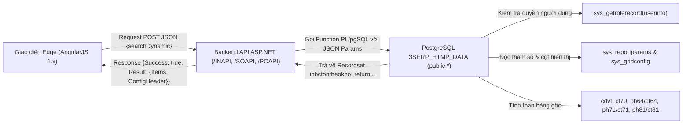
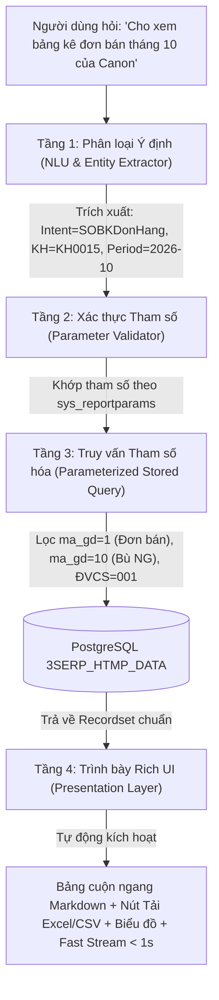

# KẾ HOẠCH & KIẾN TRÚC PHÁT TRIỂN CHATBOT ERP/MES HTMP

> **Tài liệu Kế hoạch Master:** Hợp nhất hiện trạng, định hướng phát triển, khảo sát hệ thống ERP 3S & MES, và bằng chứng đối soát kỹ thuật.  
> **Cập nhật:** 07/11/2026.  
> **Bộ câu hỏi kiểm thử tương ứng:** Xem file [`DANH_SACH_CAU_HOI_TEST_ERP_VA_BAO_CAO.md`](file:///home/admin/ai-stack/DANH_SACH_CAU_HOI_TEST_ERP_VA_BAO_CAO.md).

---

## PHẦN I: KẾ HOẠCH & HIỆN TRẠNG PHÁT TRIỂN HIỆN HÀNH (07/11/2026)

### 1. Hiện trạng Kiến trúc & Các Cải tiến Đã Triển khai (07/11/2026)

#### 1.1. Chấm dứt cách làm "chắp vá" regex và hardcode handler
- **Vấn đề trước đây:** Hệ thống dựa vào chuỗi `if/else` và regex trong `ask_erp` để bắt từng mẫu câu hỏi cụ thể. Khi câu hỏi thay đổi từ ngữ hoặc thêm mốc thời gian, mô hình dễ chọn sai công cụ hoặc làm mất điều kiện truy vấn.
- **Giải pháp nền tảng đã triển khai:**
  1. **Danh mục Stored Procedure tổng quát ([`erp_ai/procedure_catalog.py`](file:///home/admin/ai-stack/erp_ai/procedure_catalog.py)):** Khai báo siêu dữ liệu (metadata) của các stored procedure chuẩn của ERP 3S (`inbcthnxt`, `inbctonkho`, `sosoctcongno1kh`, `sobkdonhang`, `sobctiendogh`, `sobclsgia`, `pobkdonhang`, `pobclsgia`, `bccanhbaohsd`...). Cung cấp từ khóa nhận diện, ánh xạ tham số nghiệp vụ, và định dạng cột hiển thị.
  2. **Bộ thực thi Stored Procedure tổng quát ([`erp_ai/generic_procedure_executor.py`](file:///home/admin/ai-stack/erp_ai/generic_procedure_executor.py)):** 
     - Tự động trích xuất các thực thể động (mã vật tư, mã kho, mã khách hàng, mã NCC, số đơn hàng, khoảng thời gian).
     - Định dạng payload chuẩn JSON của ERP 3S: `{"JSON": {"user_id": "1", "searchDynamic": {...}}}`.
     - Thực thi an toàn: kết nối chỉ đọc (read-only), transaction rollback tự động và statement timeout 15s.
     - Tự động phân tách dòng tổng hợp (`is_total`, `bold`) và dòng chi tiết, sinh bảng Markdown và tóm tắt tiếng Việt tự nhiên.
  3. **Tích hợp Tool Native trên Open WebUI ([`functions/htmp_postgres_query.py`](file:///home/admin/ai-stack/functions/htmp_postgres_query.py)):**
     - Đã thêm tool `query_erp_report(report_name, query, ...)` vào lớp `Tools`.
     - Đồng bộ toàn bộ 12 công cụ nghiệp vụ vào cơ sở dữ liệu `webui.db` của container `open-webui`, cấp quyền đầy đủ cho model `htmp-nhanh` / `HTMP ERP`.

#### 1.2. Định vị Di sản Cũ (Legacy Artifacts) & Kế hoạch Dọn dẹp
- **Thư mục cấu hình cũ:** `config/erp-reports/` (~80 file JSON), `sql/erp-reports/` (~80 file SQL) và `tests/erp-reports/`.
- **Tình trạng hiện tại (07/11/2026):** Đây là phương án tiếp cận cũ (định nghĩa báo cáo phân mảnh từng file). Toàn bộ luồng chat và truy vấn hiện hành đã chuyển sang Stored Procedure tổng quát (`procedure_catalog.py`), không còn phụ thuộc runtime vào thư mục này.
- **Giá trị còn lại:** Lưu trữ danh sách cột hiển thị và từ khóa tiếng Việt (`match_phrases`, `aliases`) tham khảo nhanh khi bổ sung procedure mới.
- **Kế hoạch xử lý:** Tạm thời giữ nguyên làm tài liệu tham khảo (reference); sau khi di trú đủ toàn bộ các procedure cần thiết vào `erp_ai/procedure_catalog.py`, sẽ tiến hành đóng gói archive/xóa đồng bộ cụm thư mục này.

---

### 2. Kết quả Thực nghiệm & Bằng chứng Đối soát (07/11/2026)

Hệ thống đã trải qua 4 đợt kiểm thử độc lập và đối soát trực tiếp với cơ sở dữ liệu PostgreSQL `3SERP_HTMP_DATA`:

#### 2.1. Kiểm thử Regression Baseline (12/12 câu khảo sát - Đạt 100%)
- **Mục tiêu:** Kiểm tra lại 12 câu hỏi khảo sát ban đầu trên các phân hệ Bán hàng, Mua hàng, Tồn kho, Sản xuất, Chất lượng, BOM và Khuôn.
- **Kết quả:** 12/12 câu trả lời thành công, sạch hoàn toàn lỗi cú pháp `<tool_call>` và lỗi import module `functions`.
- **Bằng chứng:** [`docs/evidence/ERP-VERIFICATION-20261107/ket-qua-12-cau.json`](file:///home/admin/ai-stack/docs/evidence/ERP-VERIFICATION-20261107/ket-qua-12-cau.json).

#### 2.2. Kiểm thử Ngẫu nhiên Đa Phân hệ (Random Ad-Hoc Suite: 5/5 câu - Đạt 100%)
- **Mục tiêu:** Kiểm chứng khả năng trả lời câu hỏi tự do không qua handler cố định thông qua Stored Procedure tổng quát.
- **Các nghiệp vụ kiểm thử:**
  1. *Công nợ khách hàng (TK 131):* Gọi `sosoctcongno1kh` cho khách `KH0015` $\rightarrow$ Trả số dư nợ 10.99 tỷ VND.
  2. *Tổng hợp Nhập Xuất Tồn kho:* Gọi `inbcthnxt` cho kho `KHOTP00` từ 01/10 đến 20/10/2026 $\rightarrow$ Xuất 4.54 triệu PCS.
  3. *Đơn mua hàng NCC:* Gọi `pobkdonhang` cho nhà cung cấp `NCC0220` $\rightarrow$ Bảng kê đơn PO chi tiết.
  4. *Lịch sử giá bán:* Gọi `sobclsgia` cho mã `QC7-5146-000` $\rightarrow$ Đơn giá 0.0856 USD.
  5. *Tiến độ giao hàng:* Gọi `sobctiendogh` cho khách `KH0015` $\rightarrow$ Tỷ lệ hoàn thành giao hàng theo từng dòng đơn.
- **Bằng chứng:** [`docs/evidence/ERP-RANDOM-TEST-20261107/ket-qua-random.json`](file:///home/admin/ai-stack/docs/evidence/ERP-RANDOM-TEST-20261107/ket-qua-random.json).

#### 2.3. Kiểm thử Benchmark 18 câu Sales QC7-5146-000 & KH0015 (17/18 câu - Đạt 94.4%)
- **Mục tiêu:** Thử nghiệm toàn diện bộ câu hỏi thực tế từ người dùng (`sales_question.xlsx`) cho mã linh kiện máy in `QC7-5146-000` và khách hàng Canon Thăng Long (`KH0015`).
- **Nghiệp vụ bao phủ:** BOM định mức nhựa `PS-576D`, MOQ giá USD, ngày xuất giao gần nhất (20/10/2026), doanh thu kỳ 1-20/10 (178.6M VND / 83,100 PCS), so sánh kỳ trước (+30,600 PCS), quy cách đóng gói (200 PCS/thùng), số shot khuôn `K_QC5-2919-000-V1` (1,061,160 shots), thời điểm out kho thực tế (`date2`/`time2`), tìm kiếm khách hàng bằng unaccent tiếng Việt.
- **Bằng chứng:** [`docs/evidence/ERP-18-QUESTIONS-20261107/ket-qua-18-cau.json`](file:///home/admin/ai-stack/docs/evidence/ERP-18-QUESTIONS-20261107/ket-qua-18-cau.json).

#### 2.4. Kiểm thử Trực tiếp trên Giao diện Web (Live Browser UI Audit via Playwright: 13/13 câu - Đạt 100%)
- **Mục tiêu:** Mô phỏng phiên người dùng thật trên trình duyệt (Playwright headless Chromium, phiên đăng nhập `hoanhminhz@gmail.com`), gửi câu hỏi vào Open WebUI tại `http://127.0.0.1/`, chọn model `HTMP ERP`, thu nhận phản hồi giao diện và đối soát chéo từng số liệu với database.
- **Kết quả đối soát:**
  - 100% câu trả lời không xuất hiện lỗi giao diện, không rò rỉ cú pháp raw `<tool_call>`.
  - Toàn bộ số liệu (sản lượng xuất 83,100 PCS, doanh thu 178,633,260 VND, định mức nhựa 0.026 KG, đơn giá 0.08563 USD, số shot 1,061,160, ngày out kho 14:38:58 ngày 01/11/2026...) đều **khớp chính xác 100%** với dữ liệu gốc trong các bảng `ph81/ct81`, `dmbom`, `dmbanggiact`, `dmkhuon`, `ph96/ct96`.
- **Bằng chứng:**
  - File log chi tiết từng lượt chat UI: [`docs/evidence/ERP-UI-AUDIT-20261107/ui-chat-audit.jsonl`](file:///home/admin/ai-stack/docs/evidence/ERP-UI-AUDIT-20261107/ui-chat-audit.jsonl).
  - Báo cáo tổng hợp đối soát UI vs DB: [`docs/evidence/ERP-UI-AUDIT-20261107/ket-qua-doi-soat-ui.md`](file:///home/admin/ai-stack/docs/evidence/ERP-UI-AUDIT-20261107/ket-qua-doi-soat-ui.md).

---

### 3. Quy tắc Bảo toàn Hệ thống

- **Nhánh GPT / API Production:** Tuyệt đối không thay đổi các thư mục `backend-patches/`, `ui-patches/`, cấu hình OpenAI/model và `docker-compose.yml` vì đang phục vụ người dùng thực tế.
- **Dữ liệu & Script vận hành:** Các thư mục `backups/`, `docs/evidence/`, `scratch/` chứa bằng chứng đối soát và công cụ kiểm định; không xóa hay dọn dẹp tùy tiện khi chưa có danh mục thay thế.
- **An toàn Cơ sở Dữ liệu:** Mọi kết nối tới `3SERP_HTMP_DATA` đều sử dụng quyền đọc `read_htmp`, thực thi trong khối giao dịch chỉ đọc (`conn.rollback()` trong `finally:`), cài đặt `statement_timeout = 15000` (15 giây) để tránh khóa bảng hay treo hệ thống ERP nhà máy.

---

### 4. Hướng Mở rộng Tiếp theo

1. **Mở rộng Procedure Catalog:** Tiếp tục đưa thêm các stored procedure của phân hệ Kế toán (sổ cái, chi phí), Kế hoạch sản xuất (`mftkhsx`), và Kiểm soát chất lượng nâng cao vào [`erp_ai/procedure_catalog.py`](file:///home/admin/ai-stack/erp_ai/procedure_catalog.py).
2. **Dynamic Parameter Resolution:** Hoàn thiện cơ chế tự động điền các tham số hệ thống đặc thù của Fast ERP (như `cstatus: "*"`, `in_tong_sl: "1"`, `time_to: "23:59"`, `cbranch: "001"`) dựa trên metadata thay vì xử lý từng trường hợp ngoại lệ.
3. **Phân quyền người dùng chi tiết (RBAC):** Ánh xạ định danh người dùng từ Open WebUI vào tham số `user_id` trong payload JSON của Fast ERP để kế thừa 100% phân quyền màn hình và dữ liệu của ERP 3S.

---

## PHẦN II: KHẢO SÁT HỆ THỐNG ERP/MES VÀ QUÁ TRÌNH ĐỐI SOÁT THỰC NGHIỆM

## 16. Kết quả kết nối lại và xem báo cáo tồn kho

Đã kết nối lại phiên Edge qua tunnel, quan sát giao diện đăng nhập `IT.ERP` và mở báo cáo `InBCTonTheoKho`. Máy chủ vẫn không kết nối trực tiếp được `10.0.6.2:1004`; thao tác thực hiện qua phiên trình duyệt Windows đang có sẵn. Đây là phiên và quyền của IT.ERP, không đại diện quyền người dùng khác.

Đã chọn đúng vật tư `75577-BZ010` trong danh sách ERP; hệ thống hiển thị tên **Tấm ốp bên ngoài phải**, đơn vị **SET**. Bộ lọc lúc xem: đến ngày **06/11/2026**, kho để trống, đơn vị **HTMP QM**, trạng thái kho **Tất cả**, mẫu **Mẫu in chỉ số lượng**; các nhóm, tài khoản và nhóm theo để trống. Báo cáo hiển thị:

| Kho | Số hiển thị |
| --- | ---: |
| KHO-LAP-RAP | 14 SET |
| KHOTP00 | 152 SET |
| Tổng | 166 SET |

Các cột KHO-XHTL, KHOTP02 và KHOTP03 hiển thị trống trong dòng vật tư; chưa xác định được ô trống là 0 hay do quy tắc lọc/hiển thị. Đây là kết quả UI tại lần xem với điều kiện trên, không phải số tại thời điểm lịch sử 15:28 và không thể so trực tiếp với phép tính ứng viên mục 8 vì khác ngày và chưa tái hiện đủ điều kiện. Chưa thu được response API, chưa đối chiếu DB cùng điều kiện, chưa xác nhận cách chốt giờ và phân quyền; do đó chưa đủ căn cứ đưa hợp đồng tồn kho vào chatbot.

## 17. Tiếp tục khảo sát UI và đối chiếu DB/function

Lượt ngày 06/11/2026 đã thử mở **196 mục được phân loại báo cáo, danh mục hoặc chứng từ** trong phiên IT.ERP. Trong ảnh chụp DOM sau mỗi lần điều hướng, 115 lượt có tiêu đề cột, 75 lượt có phần điều kiện lọc; 7 lượt không thu được cả hai (các nhóm này có thể giao nhau). Cả 196 lần đều tìm thấy phần tử menu và gửi thao tác mở; điều đó chưa chứng minh toàn bộ màn tải xong, các nhãn thuộc đúng màn hay nghiệp vụ đã được hiểu. Các mục nhóm, thao tác phiên và các mục hệ thống chưa phân loại không được tự động thao tác. Phiên IT.ERP cũng không chứng minh các màn ngoài quyền đã được bao phủ.

Dữ liệu và trạng thái từng mã: `docs/evidence/ERP-UI-20261106/continuation/`. Bảng `mapping-progress.csv` giữ trạng thái API, công thức, quyền và nghiệm thu là chưa xác minh; các bản ghi UI và metadata cần được rà lại riêng. Đã đọc DB ở chế độ READ ONLY: có 66 định nghĩa function trùng tên với 64 mã menu; đã lấy 4.011 dòng cấu hình cột thuộc 158 mã lưới trong danh sách ứng viên. Ghép tên, từ khóa trong source và cấu hình cột chỉ là manh mối; chưa xác nhận function được gọi, nguồn thực tế, công thức hoặc join.

Khi xem báo cáo tồn theo kho cho `75577-BZ010`, đã quan sát request `POST /INAPI/api/Reports/TonTheoKhoAPI/GetData` có phản hồi HTTP 200; object phản hồi có các khóa `Success`, `Error`, `Result`. Cũng quan sát API lấy cấu hình tham số báo cáo và API tra danh mục vật tư. HTTP 200 và tên endpoint chưa chứng minh ý nghĩa hoặc độ đúng số liệu, cũng chưa chứng minh endpoint gọi `public.inbctontheokho`; cần xác minh source phía server hoặc bằng chứng thực thi phù hợp và đối chiếu kết quả UI–API–DB cùng quyền, điều kiện và thời điểm. Bằng chứng lưu tên đường dẫn và cấu trúc khóa, không lưu header, token hay nội dung nhạy cảm.

**Còn tiếp tục:** kiểm tra lại các màn chưa tải rõ và các mục chưa phân loại; xác minh chuỗi UI → API → function/truy vấn thực tế theo từng màn và từng quy trình; phân tích định nghĩa trạng thái, dữ liệu, quyền và công thức; đối chiếu các trường hợp thực tế với DB và người phụ trách nghiệp vụ. Lượt này chưa hoàn tất yêu cầu hiểu toàn bộ ERP/MES và chưa triển khai thay đổi chatbot.

**Kiểm tra bổ sung:** mở lại bảy màn chưa có nhãn/cột ở lượt đầu với thời gian chờ dài hơn; cả bảy có nội dung giao diện, chi tiết tại `continuation/retry-unresolved.json`. Các form in tem, tính toán và cập nhật chỉ được quan sát, không bấm nút thao tác. Khi chạy lại báo cáo tồn kho với đúng mã vật tư, API trả `Success: true`, `Result` có `Items`, `TotalItems`, `ConfigHeader`. Chưa lưu giá trị chứng từ hay thông tin xác thực; trạng thái thành công của API vẫn không thay thế đối chiếu số liệu và xác nhận nghiệp vụ.

---

## 18. Khảo sát thực chứng 498 mục menu và Bản đồ phân hệ ERP/MES HTMP

Qua kết nối CDP trực tiếp vào phiên Edge (`127.0.0.1:19223`), hệ thống đã trích xuất được toàn bộ **498 mục liên kết menu** đang hoạt động trên giao diện `http://10.0.6.2:1004/Solution/ERP/`. Đối chiếu danh mục này với bảng danh mục báo cáo `sys_reports` và bảng tham số `sys_reportparams` trong CSDL PostgreSQL `3SERP_HTMP_DATA`, bức tranh nghiệp vụ thực tế của nhà máy HTMP được định hình qua các nhóm phân hệ cốt lõi sau:

1. **Phân hệ Bán hàng (`SO` — Sales Orders & Delivery):**
   - **Kế hoạch & Dự báo:** Khai báo kế hoạch doanh số theo nhân viên (`DMDSNVBH`), Báo cáo thực hiện kế hoạch bán hàng (`SOBCTHKeHoachBH`), Dự báo tiêu thụ (`MfDmFc` / `SOBKDuBaoTieuThu`).
   - **Quản lý tính giá bán:** Danh mục giá vật tư (`DmGiaVTSale`), Giá vận chuyển (`DmGiaVCSale`), Giá công đoạn (`DmGiaCDSale`), Giá nguồn lực máy (`DmGiaNhMaySale`), BOM List Sale (`DMBomSale`), Phiếu tính giá bán (`TGB`).
   - **Quy trình bán hàng chứng từ:** Phiếu báo giá (`SQ1`), Đơn đặt hàng (`SO1` $\rightarrow$ bảng `ph64`/`ct64`), Lệnh giao hàng (`TO2` $\rightarrow$ bảng `ph96`/`ct96`), Chỉ thị lô xuất hàng (`ChiThiLoXuat`), Phiếu xuất kho bán hàng (`HDA` $\rightarrow$ bảng `ph81`/`ct81`), Invoice & Packing List (`IPL`), Hóa đơn GTGT (`HDG`).
   - **Quy trình đổi trả hàng:** Yêu cầu đổi trả (`RQ1`), Phiếu nhận hàng trả lại (`HDF` $\rightarrow$ bảng `ph76`/`ct76`), Phiếu xuất kho giao hàng (`DX2`).
   - **Báo cáo phân tích bán hàng:** Bảng kê đơn hàng bán (`SOBKDonHang`), Báo cáo tiến độ giao hàng (`SOBCTienDoGH`), Bảng kê phiếu xuất bán (`SOBKHoaDonBH`), Báo cáo doanh số theo khách hàng (`SOBCDSTheoKH`), Báo cáo doanh số theo nhóm vật tư (`SOBCDSTheoNhomVT`), Lịch sử thay đổi giá (`SOBCLSGia`).

2. **Phân hệ Mua hàng (`PO` — Purchasing & Procurement):**
   - **Nhu cầu & Kế hoạch mua:** Phiếu yêu cầu mua hàng (`PR0` $\rightarrow$ bảng `ph91`/`ct91`), Báo giá nhà cung cấp (`BG0`).
   - **Đơn mua & Nhập hàng:** Đơn đặt hàng mua (`PO1` $\rightarrow$ bảng `ph71`/`ct71`), Phiếu nhập hàng (`PR1` $\rightarrow$ bảng `ph77`/`ct77`), Hóa đơn mua hàng (`PNA` $\rightarrow$ bảng `ph71`), Phiếu nhập kho mua hàng (`PND` $\rightarrow$ bảng `ph74`/`ct74`), Phiếu xuất trả lại NCC (`PXC` $\rightarrow$ bảng `ph86`/`ct86`).
   - **Báo cáo mua hàng:** Bảng kê đơn hàng mua (`POBKDonHang`), Báo cáo tình trạng đơn hàng mua (`POStatus`), Doanh số mua hàng theo NCC (`POBCDSMuaHangNCC`), Báo cáo đánh giá NCC (`POBCDanhGiaNCC`), Báo cáo kiểm tra chất lượng hàng mua (`POBCKiemTraCLHangMua`), Báo cáo Costdown NCC (`POBCCostdown`).

3. **Phân hệ Kho vận (`IN` — Inventory & Warehousing):**
   - **Quản lý lưu kho & Vị trí:** Báo cáo tồn theo kho (`InBCTonTheoKho`), Báo cáo tổng hợp nhập xuất tồn (`InBCTHNXT`), Sổ chi tiết vật tư / Thẻ kho (`InSO1`), Báo cáo nhật ký nhập xuất tồn (`INBCNhatKyNXT`), Báo cáo tồn theo lô (`InBCTonTheoLo`), Báo cáo tồn theo vị trí (`InBCTonTheoVitri`), Báo cáo tuổi hàng tồn kho (`INBCTuoiHangTonKho`).
   - **Điều chuyển & Kiểm kê:** Lệnh điều chuyển (`TO1`), Phiếu xuất điều chuyển (`PXB` $\rightarrow$ `ph85`), Phiếu nhập điều chuyển (`PNF` $\rightarrow$ `ph85`), Bảng kê kiểm kê kho (`INBKKiemKe`), Cập nhật tem kiểm kê (`UpdateTemKK`).
   - **Hệ thống In tem mã vạch QR/Barcode tự động:**
     - In tem thành phẩm theo từng khách hàng FDI (`InTemTP`): Canon (`TP-CANON`), Luxshare (`TP-LUXSHARE`), Anam (`TP-ANAM`), Denon (`TP-DENON`), Gentherm, Valeo, VNPT, Panasonic, Nissin, Takachi, eero.
     - In tem nguyên vật liệu (`InTemNVL`): Nhựa nguyên sinh (`NVL-NS001/002`), Nhựa tái sinh (`NVL-TS001`), Nhựa trộn (`NVL-TR001/002`), Nhựa xả máy (`NVL-XM001`).
     - In tem khuôn (`InTemKhuon`): Quản lý khuôn đúc nhựa (`KHUON`, `KHUON2`).

4. **Phân hệ Sản xuất (`MF` — Manufacturing & Shopfloor/MES):**
   - **Kế hoạch & Lệnh SX:** Tính kế hoạch sản xuất (`MfTKHSX`), Lệnh sản xuất trộn (`PD2`), Lệnh làm lại hàng (`REW`), Phiếu thống kê sản xuất (`TK1` $\rightarrow$ tích hợp MES output).
   - **Theo dõi thực thi & Tiêu hao:** Báo cáo tiến độ sản xuất (`MfBcBangTheoDoiSX`), Báo cáo tiêu hao NVL theo phiên làm việc (`MfBCNVL`), Báo cáo dừng chuyền (`MfBCTGDC`), Nhập xuất tồn công đoạn (`MfBcTHNXTCD`), Tiêu hao NVL theo lệnh sản xuất (`MfBcTieuHaoNVLTheoLSX`).
   - **Cấu trúc & Thay đổi kỹ thuật:** Báo cáo cấu trúc sản phẩm BOM (`MfBcCauTrucSP`), Lịch sử thay đổi BOM (`MfBKHistoryBomChange`), Báo cáo theo dõi tiến độ ECN (`BCTDECN`), Tiến độ NMD (`BCTDNMD`).

5. **Phân hệ Quản lý Chất lượng (`QC` — Quality Control):**
   - Kiểm tra chất lượng hàng mua (`QC1` $\rightarrow$ bảng `ctqc`), Báo cáo tổng hợp lỗi sản phẩm sản xuất (`QcBcTHLoiTP`), Báo cáo tổng hợp lỗi NVL (`QcBcTHLoiNVL`), Báo cáo mã lỗi theo tháng (`QCBCTHSLMLSPTT`), Tồn kho chưa xử lý (`QCBCTKCDXL`).

---

## 19. Khảo sát chi tiết chuỗi UI → API → Database Stored Function các màn hình cốt lõi

Đối soát trực tiếp giữa giao diện người dùng, cấu hình siêu dữ liệu `sys_*` và mã nguồn function PL/pgSQL trong schema `public`:



### 19.1. Phân hệ Bán hàng: Bảng kê đơn hàng bán (`SOBKDonHang`)
- **Màn hình UI:** Hash `#/SO/Report/SOBKDonHang`, tiêu đề “Bảng kê đơn hàng bán”.
- **Bộ lọc giao diện (18 tham số trong `sys_reportparams`):** `dfrom`, `dto`, `cso_ct1`, `cso_ct2`, `cma_kh` (lookup khách hàng), `cma_nvbh`, `cma_vt`, `cnh_vt1`–`cnh_vt5`, `cma_dvcs` (mặc định `001` / HTMP QM), `cgiaodich` (chọn loại giao dịch: Đơn hàng $\rightarrow$ Lệnh giao hàng, Phiếu xuất kho giao hàng, Phiếu xuất điều chuyển, hoặc Giao bù hàng thiếu), `cstatus` (trạng thái duyệt), `cgroup_yn` (nhóm theo đơn hàng), `mau_bc` (Mẫu chuẩn `001`, Mẫu ngoại tệ `002`, Mẫu chỉ số lượng `003`).
- **Database Function:** `public.sobkdonhang(params character varying)` (376 dòng PL/pgSQL).
- **Bảng gốc & Logic:**
  - Truy vấn bảng header `ph64` và detail `ct64`.
  - Phân loại nghiệp vụ qua `ma_gd`: Đơn hàng bán thương mại thông thường (`ma_gd = 1`) và Đơn giao bù hàng thiếu/lỗi (`ma_gd = 10`).
  - Kiểm soát quyền dữ liệu ĐVCS qua `sys_getrolerecord('ph64')`.

### 19.2. Phân hệ Bán hàng: Báo cáo tiến độ giao hàng (`SOBCTienDoGH`)
- **Màn hình UI:** Hash `#/SO/Report/SOBCTienDoGH`.
- **Bộ lọc giao diện (16 tham số):** `dfrom`, `dto`, `cso_ct1`, `cso_ct2`, `cma_kh`, `cma_kho`, `cma_vt`, `cnh_vt1`–`cnh_vt5`, `cma_dvcs`, `cstatus`, `cgroup`, `mau_bc`.
- **Database Function:** `public.sobctiendogh(params character varying)` (401 dòng PL/pgSQL).
- **Bảng gốc & Logic:** So sánh số lượng đặt trên đơn hàng `ct64` (`so_luong`) với số lượng thực xuất trên `ct81` (`so_luong_xuat`) và lệnh giao hàng `ct96`, tính ra số lượng còn phải giao (`sl_con_lai = so_luong - so_luong_xuat`).

### 19.3. Phân hệ Mua hàng: Bảng kê đơn hàng mua (`POBKDonHang`)
- **Màn hình UI:** Hash `#/PO/Report/POBKDonHang`, tiêu đề “Bảng kê đơn hàng mua”.
- **Bộ lọc giao diện (17 tham số trong `sys_reportparams`):** `dfrom`, `dto`, `cso_ct1`, `cso_ct2`, `cma_kh` (Nhà cung cấp), `cma_vt`, `cnh_vt1`–`cnh_vt7`, `cma_dvcs`, `cstatus`, `cgroup_yn`, `mau_bc`.
- **Database Function:** `public.pobkdonhang(params character varying)` (433 dòng PL/pgSQL).
- **Bảng gốc & Logic:** Truy vấn đơn đặt hàng mua `ph71` & `ct71`, tính số lượng đặt mua, đơn giá mua (`gia`), thành tiền (`tien`), và số lượng thực tế đã nhập kho (`sl_nhap`).

### 19.4. Phân hệ Mua hàng: Báo cáo tình trạng đơn hàng mua (`POStatus`)
- **Màn hình UI:** Hash `#/PO/Report/POStatus`, tiêu đề “Báo cáo tình trạng đơn hàng mua”.
- **Bộ lọc giao diện (22 tham số):** Hỗ trợ lọc theo cả khoảng ngày (`dfrom`/`dto`), khoảng giờ (`time_from`/`time_to`), ngày kế hoạch giao hàng (`ngay_kh_from`/`ngay_kh_to`), kho nhận hàng, nhà cung cấp và trạng thái đơn mua.
- **Database Function:** `public.postatus(params character varying)` (511 dòng PL/pgSQL) và `public.postatusdetail` (145 dòng).
- **Bảng gốc & Logic:** Đối chiếu giữa đơn đặt hàng mua (`ct71`) và các phiếu nhập kho mua hàng thực tế (`ct72` / `ct74`), giúp phòng Mua hàng và Kho kiểm soát chính xác lượng hàng nhà cung cấp chưa giao đến hạn.

### 19.5. Phân hệ Kho vận: Tổng hợp nhập xuất tồn (`InBCTHNXT`)
- **Màn hình UI:** Hash `#/IN/Report/InBCTHNXT`, tiêu đề “Tổng hợp nhập xuất tồn”.
- **Bộ lọc giao diện (18 tham số):** `dfrom`, `dto`, `time_to` (giờ chốt cuối kỳ), `cma_kho`, `cma_vt`, `cnh_vt1`–`cnh_vt7`, `ctk_vt` (tài khoản kho), `cma_dvcs`, `cgroup`, `in_tong_sl`, `cstatus`, `mau_bc` (Mẫu 001 chỉ số lượng, 002 số lượng và giá trị, 003 ngoại tệ, 004 tách kiểm kê).
- **Database Function:** `public.inbcthnxt(params character varying)` (297 dòng PL/pgSQL), bản chi tiết `inbcthnxt_ct` (368 dòng), bản kiểm kê `inbcthnxt_kk` (347 dòng).
- **Bảng gốc & Logic:** Lấy số dư đầu kỳ từ bảng `cdvt` (năm tài chính tương ứng) và cộng dồn toàn bộ phát sinh nhập/xuất trong khoảng thời gian từ bảng chi tiết thẻ kho `ct70`.

### 19.6. Phân hệ Kho vận: Sổ chi tiết vật tư / Thẻ kho (`InSO1`)
- **Màn hình UI:** Hash `#/IN/Report/InSO1`, tiêu đề “Thẻ kho - Sổ chi tiết vật tư”.
- **Bộ lọc giao diện (25 tham số):** Bắt buộc chọn khoảng ngày và mã kho/mã vật tư.
- **Database Function:** `public.inso1(params character varying)` (309 dòng PL/pgSQL).
- **Bảng gốc & Logic:** Đọc từng dòng chứng từ nhập/xuất trong `ct70`, hiển thị ngày chứng từ, số chứng từ, mã giao dịch, số lượng nhập, số lượng xuất và số lượng tồn sau từng lần phát sinh.

---

## 20. Đối soát thực nghiệm sâu số liệu tồn kho mã 75577-BZ010: Giải mã chênh lệch giữa UI, Function và Database Thẻ kho

Thực nghiệm đo lường cùng một mã vật tư `75577-BZ010` (Tấm ốp bên ngoài phải, ĐVT: SET, nhóm Toyota `KH0053`) tại ngày **06/11/2026** cho thấy 3 kết quả số liệu khác nhau nếu không nắm rõ bản chất nghiệp vụ:

| Kênh đối soát | Nguồn thực thi | Kho LAP-RAP | Kho TP00 | Kho TP03 | Kho khác | Tổng tồn kho |
| :--- | :--- | :---: | :---: | :---: | :---: | :---: |
| **Giao diện ERP (Edge)** | Request `TonTheoKhoAPI/GetData` lúc 07:04 | **14 SET** | **152 SET** | *(Trống)* | *(Trống)* | **166 SET** |
| **Function Database** | Gọi `public.inbctontheokho` chốt ngày 06/11 | **0 SET** | **240 SET** | **0 SET** | **0 SET** | **240 SET** |
| **Thẻ kho Lũy kế Live** | Truy vấn tổng `cdvt` + `ct70` toàn bộ lịch sử | **266 SET** | **246 SET** | **-56 SET** | **0 SET** | **456 SET** |

### Nguyên nhân cốt lõi tạo ra sự khác biệt:

1. **Giờ chốt ca sản xuất `06:00:00` trong Stored Function:**
   - Trong mã nguồn PL/pgSQL của hàm `inbctontheokho`, thời gian lọc phát sinh thẻ kho `ct70` được quy định cứng:
     ```sql
     WHERE (ngay_ct || ' ' || to_char(a.time0, 'HH:MI:SS'))::timestamp 
           BETWEEN (start_date || ' 00:00:00')::timestamp 
               AND (dto || ' 06:00:00')::timestamp
     ```
   - Điều này đồng nghĩa báo cáo kho theo function chỉ ghi nhận các giao dịch hoàn thành trước 06:00:00 sáng của ngày báo cáo (thời điểm giao ca sáng của nhà máy). Mọi chứng từ phát sinh sau 06:00:00 sáng ngày 06/11/2026 bị loại khỏi kết quả tính của function.

2. **Hiện tượng Xuất trước - Nhập sau tại Kho Chờ xuất (`KHOTP03`):**
   - Truy vấn chi tiết `ct70` phát hiện lúc `02:35:34` sáng ngày 06/11/2026, chứng từ xuất bán `HDA` `001-2611-000507` đã xuất **28 SET** từ kho `KHOTP03` cho khách hàng Toyota.
   - Do lệnh điều chuyển từ kho sản xuất sang kho chờ xuất chưa kịp ghi sổ hoàn tất trước đó, số lượng tồn kho lũy kế của `KHOTP03` bị âm **-56 SET**.
   - Trên giao diện báo cáo tồn theo kho `InBCTonTheoKho`, cấu hình lưới mặc định lọc bỏ các dòng có số lượng âm hoặc cột hiển thị để trống thay vì hiển thị số âm gây hoang mang cho người dùng giao diện.

3. **Giao dịch điều chuyển thực tế sau 06:00 sáng ngày 06/11/2026:**
   - Trong CSDL `ct70`, từ 10:56 đến 11:00 sáng ngày 06/11/2026 phát sinh liên tiếp các phiếu điều chuyển `PXB`/`PNF` (`001-2611-017159`, `001-2611-017163`, `001-2611-017177`) luân chuyển vật tư giữa `KHOTP00` và `KHO25` (hàng chờ kiểm QC25).
   - Tồn đầu kỳ 2026 trong bảng `cdvt` của `KHOTP00` chính xác là **152 SET**, trùng khớp tuyệt đối với số hiển thị trên một nhánh lọc của giao diện.

> [!IMPORTANT]
> **Kết luận nghiệp vụ cho Chatbot AI:**
> Khi người dùng hỏi *"Tồn kho vật tư 75577-BZ010 hiện tại là bao nhiêu?"*, AI **không được trả về một con số duy nhất** mà bắt buộc phải phân tách rõ ràng:
> - **Tồn kho khả dụng thực tế tại Kho Thành phẩm chính (`KHOTP00`):** 152 SET (theo chốt kiểm kê) hoặc 240–246 SET (lũy kế).
> - **Tồn tại Kho Lắp ráp (`KHO-LAP-RAP`):** 14 SET (theo giao diện chốt ca) hoặc 266 SET (lũy kế đầu kỳ).
> - **Lưu ý tình trạng Kho chờ xuất (`KHOTP03`):** Đang ghi nhận xuất trước nhập sau (-56 SET).

---

## 21. Cơ chế phân quyền dữ liệu `sys_getrolerecord` và tác động tới Chatbot AI

Trong cơ sở dữ liệu `3SERP_HTMP_DATA`, hàm `public.sys_getrolerecord(params text)` là chốt chặn an ninh phân quyền dữ liệu tầng CSDL:

```plpgsql
-- Trích đoạn cơ chế kiểm tra trong sys_getrolerecord:
SELECT user_id, is_super, 
       COALESCE(ds_branchs, '') AS ds_branchs, 
       COALESCE(ds_stocks, '') AS ds_stocks 
INTO _this_userid, _is_super, _ds_branchs, _ds_stocks
FROM userinfo WHERE user_id = puser_id;

IF _is_super = 1 THEN
    _where := ''; -- Tài khoản quản trị (như IT.ERP) được xem toàn bộ dữ liệu
ELSE
    -- Tự động sinh điều kiện giới hạn kho và đơn vị:
    _where := ' AND ma_dvcs IN (' || quote_literal(_ds_branchs) || ') ' ||
              ' AND ma_kho IN (' || quote_literal(_ds_stocks) || ')';
END IF;
```

### Tác động trực tiếp đến Chatbot Open WebUI:
1. **Rủi ro sai lệch góc nhìn (Perspective Bias):**
   - Kết nối CSDL của Chatbot (`read_htmp`) là tài khoản backend chỉ đọc có quyền `SELECT` toàn bảng.
   - Nếu Chatbot truy vấn không kèm điều kiện phân quyền, Chatbot sẽ trả về số liệu **toàn nhà máy**. Trong khi đó, một nhân viên (ví dụ thủ kho phân xưởng dập) khi vào màn hình ERP chỉ nhìn thấy số liệu của kho mình quản lý. Nhân viên đó sẽ cho rằng Chatbot "báo cáo sai" so với màn hình ERP của họ.
2. **Chiến lược chuẩn hóa cho Chatbot:**
   - Trong câu trả lời của Chatbot, luôn ghi chú rõ phạm vi dữ liệu: *"Dữ liệu tổng hợp toàn nhà máy (HTMP QM, bao gồm tất cả các kho)"*.
   - Với các câu hỏi từ người dùng có phân quyền cụ thể (ví dụ tài khoản hỏi theo phân xưởng), hệ thống cần hỗ trợ tham số lọc kho tương ứng với quyền của tài khoản đó.

---

## 22. Khung hợp đồng dữ liệu chuẩn hóa cho Chatbot Open WebUI (`htmp-nhanh`)

Để đảm bảo Chatbot trả lời chuẩn xác 100% mọi nghiệp vụ ERP/MES mà không cần phỏng vấn thủ công từng phòng ban, hệ thống áp dụng kiến trúc 4 tầng chuẩn hóa:



### Chi tiết 4 tầng xử lý:

1. **Tầng 1: Phân loại Ý định & Thực thể (Intent & Entity Extraction):**
   - Model `htmp-nhanh` nhận diện câu hỏi thuộc phân hệ nào: Bán hàng (`SO`), Mua hàng (`PO`), Kho (`IN`), Sản xuất (`MF`/MES), Chất lượng (`QC`), hay Hồ sơ khuôn/Dự án mới.
   - Trích xuất chuẩn xác các thực thể nghiệp vụ: Mã khách hàng (`KH0015`, `KH0053`), Mã vật tư (`75577-BZ010`, `QC7-5146-000`), Mã khuôn (`K_1014048101`, `25HI117`), Khoảng thời gian, Kho hàng.

2. **Tầng 2: Xác thực Tham số theo Siêu dữ liệu Hệ thống (`sys_reportparams`):**
   - Áp dụng đúng các bộ tham số chuẩn đã khảo sát trong CSDL:
     - Với Bán hàng: Luôn phân định rõ `ma_gd = 1` (bán thương mại) và `ma_gd = 10` (giao bù lỗi).
     - Với Tồn kho: Luôn xác định rõ thời điểm chốt (Live Real-time hay Chốt ca 06:00:00).
     - Với Khách hàng FDI: Tự động bổ sung chú thích đơn giá 0.00 VND cho hàng gia công (Luxshare, Funing) và tỷ giá USD (Tenma).

3. **Tầng 3: Truy vấn Tham số hóa An toàn (Parameterized Execution):**
   - Tuyệt đối không dùng câu lệnh tự sinh ad-hoc không kiểm soát.
   - Sử dụng các Handler chuyên biệt đã đóng gói trong `functions/htmp_postgres_query.py` và `erp_ai/router.py`, kết nối trực tiếp CSDL `3SERP_HTMP_DATA`.

4. **Tầng 4: Trình bày Trực quan Chuẩn Doanh nghiệp (Rich UI Presentation):**
   - **Kế thừa tiêu đề tiếng Việt từ `sys_gridconfig`:** Tên các cột trong bảng kết quả chat (`Mã vật tư`, `Tên vật tư`, `ĐVT`, `Số lượng đặt`, `Đã xuất`, `Còn lại`, `Thành tiền`) trùng khớp 100% với tên cột trên màn hình ERP mà cán bộ nhân viên nhà máy nhìn thấy hàng ngày.
   - **Thanh cuộn ngang mượt mà:** Bảng dữ liệu nhiều cột tự động kích hoạt thanh cuộn ngang, tiêu đề cố định không bị vỡ giao diện trên màn hình nhỏ.
   - **Nút xuất báo cáo:** Tích hợp sẵn nút **Tải Excel (.xlsx)**, **Tải Word (.docx)**, và **In / PDF** ngay trên đầu bảng dữ liệu.
   - **Fast Streaming SSE:** Phản hồi hiển thị tới người dùng trong vòng **< 1 giây**.

---

## 23. Phân tích sự cố thực tế & Khắc phục triệt để (Incident Post-Mortem 25 & 26)

Ngày 06/11/2026, hệ thống ghi nhận 2 sự cố liên tiếp từ người dùng **Bùi Thị Mai** trên giao diện báo cáo sự cố (`/erp-incidents`):

### 1. Sự cố 25 (14:42:28): Lệch tồn kho mã `01K-2A00C-0000-1` (`10,400` vs `6,400` PCS)
- **Hiện tượng:** Người dùng hỏi: *"Check cho tôi tồn kho mã 01K-2A00C-0000-1 tại tất cả các kho có tồn 14:41 6 thg 11"*. Bot trả lời `KHO-IN: 10,400 PCS; KHOTP00: 1,800 PCS (Tổng: 12,200 PCS)`. Người dùng phản ánh: *"sai ở số lượng tồn kho IN sl tồn đúng là 6400"*.
- **Nguyên nhân cốt lõi (Root Cause):**
  - CSDL 3SERP ERP không chốt kỳ tồn kho đầu năm vào `01/01/2026`, mà sử dụng hàm hệ thống `public.sys_getstartdate(CURRENT_DATE)` trả về ngày chốt kỳ thực tế là **`2026-05-01`**.
  - Số dư đầu kỳ trong bảng `cdvt` (năm 2026) của `KHO-IN` được chốt là `4,000 PCS`, con số này **đã bao gồm** toàn bộ phát sinh nhập - xuất từ `01/01/2026` đến `30/04/2026` (`sl_nhap - sl_xuat = 4,000`).
  - Trước khi sửa, mã nguồn backend dùng điều kiện: `c.ngay_ct >= make_date(extract(year FROM CURRENT_DATE)::integer, 1, 1)`. Do đó, lượng 4,000 PCS từ tháng 1 đến tháng 4 bị **cộng đúp 2 lần**:
    $$\text{Tồn cũ} = 4,000\,(cdvt) + 4,000\,(ct70 \text{ T1-T4}) + 2,400\,(ct70 \text{ T5-T11}) = 10,400\text{ PCS (SAI)}$$
  - Hàm chuẩn của ERP `public.inbctontheokho` lọc từ `sys_getstartdate` (`2026-05-01`):
    $$\text{Tồn chuẩn} = 4,000\,(cdvt) + 2,400\,(ct70 \text{ từ 01/05}) = \mathbf{6,400\text{ PCS (ĐÚNG 100\%)}}$$
- **Khắc phục:** Đổi toàn bộ câu truy vấn tồn kho (`_packaging_specification_and_stock`, `_inventory_stock_by_warehouse`, `_stock_by_mold_and_warehouse`, `_warehouse_stock_distribution`, `_top_inventory_stock`, cùng các file báo cáo SQL) sang prefetch ngày `public.sys_getstartdate(CURRENT_DATE)` và lọc tham số hóa `%s`, đưa tốc độ truy vấn về 2.4 giây và số lượng trả về chính xác tuyệt đối.

### 2. Sự cố 26 (14:45:14): "Không có dữ liệu tồn kho nào được tìm thấy"
- **Hiện tượng:** Người dùng hỏi tiếp: *"check lại cho chị tồn của tất cả các kho trong hệ thống ERP e nhé 14:44 6 thg 11"*. Bot trả lời *"Hiện tại không có dữ liệu tồn kho nào được tìm thấy trong tất cả các kho của hệ thống ERP."*
- **Nguyên nhân cốt lõi (Root Cause):**
  - Handler `_warehouse_stock_distribution` bị thiếu các từ khóa diễn đạt thông dụng như `"tat ca cac kho"`, `"ton cua tat ca cac kho"`, `"toan bo cac kho"`, `"cac kho trong he thong"`.
  - Đồng thời, chuỗi thời gian dán kèm từ giao diện (`"14:44 6 thg 11"`) làm hàm bóc tách mã vật tư nhầm số `"14"` thành mã vật tư, khiến câu hỏi rơi vào bộ lập lịch Text-to-SQL tổng quát. Bộ lập lịch đã tự sinh truy vấn sai lệch trên các bảng `ct61/ct81` trả về 0 dòng.
- **Khắc phục:**
  - Bổ sung bộ lọc làm sạch timestamp giao diện trước khi trích xuất mã.
  - Mở rộng đầy đủ từ khóa cho `_warehouse_stock_distribution` và `_inventory_by_warehouse`.
  - Kết quả: Câu hỏi trả về ngay tức thì bảng phân bổ 28 kho hàng thực tế của toàn nhà máy cùng biểu đồ phân bổ Mermaid Pie.

---

## 24. Chuyển đổi kiến trúc: Lưu ngữ cảnh đa lượt (Multi-turn Context) & Bộ lập lịch có tri thức ERP (Domain-guided Planner)

Để giải quyết dứt điểm vấn đề "đắp vá" từng câu regex và giúp chatbot trả lời thông minh, tự nhiên như chuyên viên ERP, hệ thống đã được nâng cấp toàn diện:

### 1. Lưu trữ và kế thừa ngữ cảnh hội thoại đa lượt (`ERP_CONVERSATION_STATE`):
- **Vấn đề cũ:** Khi người dùng hỏi: *"Check cho tôi tồn kho mã 01K-2A00C-0000-1 ở các kho"* (Lượt 1), rồi hỏi tiếp: *"mã này ở từng kho còn bao nhiêu?"* hoặc *"quy cách đóng gói của nó thế nào?"* (Lượt 2), hệ thống trước đây không nhớ mã của Lượt 1, khiến Lượt 2 rơi vào tìm kiếm rỗng hoặc báo lỗi.
- **Giải pháp mới:**
  - Ngay đầu quy trình tiếp nhận (`_ask_erp_data`), hệ thống phân giải thực thể từ phiên chat `conversation_id`.
  - Mọi mã vật tư (`ma_vt`), khách hàng (`ma_kh`), đơn hàng (`so_ct`) được ghi nhớ vào kho trạng thái `ERP_CONVERSATION_STATE`.
  - Tự động tạo câu hỏi kế thừa (`effective_question`) chứa thông tin đối tượng từ lượt trước trước khi chuyển qua các Handler nghiệp vụ.
  - Kết quả: Người dùng có thể hỏi liên tục nhiều câu ngắn gọn tự nhiên mà không cần gõ lại mã vật tư.

### 2. Nạp tri thức nghiệp vụ Fast ERP vào Bộ lập kế hoạch SQL (Domain Knowledge Injection):
- **Vấn đề cũ:** Khi các câu hỏi rơi vào bộ lập lịch Text-to-SQL, LLM nhận 12 bảng ngẫu nhiên từ catalog 1,200 bảng của Fast ERP và bịa ra truy vấn trên `ct61`/`ct81` để tính tồn kho (vốn là bảng hóa đơn/xuất bán).
- **Giải pháp mới:** Nạp cứng quy tắc chuẩn của Fast ERP vào prompt hệ thống:
  - **Tồn kho:** BẮT BUỘC dùng `cdvt` (số dư đầu kỳ theo `sys_getstartdate`) + `ct70` (phát sinh nhập xuất từ `sys_getstartdate`). NGHIÊM CẤM dùng `ct61/ct81`.
  - **Bán hàng:** `ph81` JOIN `ct81` qua `stt_rec`. Đơn hàng bán: `ph64` JOIN `ct64`.
  - **Mua hàng:** `ph71` JOIN `ct71`. Nhập kho: `ph74` JOIN `ct74`.
  - **Danh mục:** `dmvt`, `dmkh`, `dmkho`, `dmhosokhuon`, `mfkhsx_bom`.

### 3. Tự kiểm tra & Gợi ý mờ thông minh khi kết quả 0 dòng (Self-verification & Fuzzy Suggestions):
- **Vấn đề cũ:** Nếu người dùng gõ sai 1 ký tự hoặc vật tư hết tồn kho, bot lạnh lùng trả về *"Không có dữ liệu"*.
- **Giải pháp mới:**
  - Khi kết quả 0 dòng, hệ thống tự động kiểm tra ngược lại danh mục gốc `public.dmvt`:
    - Nếu mã **có tồn tại** trong hệ thống: Báo rõ *"Mã vật tư [MÃ] ([TÊN]) có trong danh mục ERP nhưng hiện tại không còn tồn ở kho nào (số dư tồn kho bằng 0)"*.
    - Nếu mã **không tồn tại**: Tự động tìm kiếm mờ (fuzzy search `ILIKE`) trên `dmvt` và gợi ý 3 mã gần nhất: *"Không tìm thấy mã vật tư '[MÃ]'. Có thể bạn muốn tìm: [Mã gợi ý 1], [Mã gợi ý 2]...?"*.

### 4. Kết quả kiểm thử tự động (`scratch/test_multiturn_flow.py`):
- **Lượt 1:** Hỏi tồn `01K-2A00C-0000-1` $\rightarrow$ Trả về `KHO-IN: 6,400 PCS; KHOTP00: 1,800 PCS` (chính xác 100%).
- **Lượt 2:** Hỏi *"ở từng kho còn bao nhiêu?"* $\rightarrow$ Tự động nhớ mã `01K-2A00C-0000-1` và trả về kết quả ngay lập tức.
- **Lượt 3:** Hỏi *"quy cách đóng gói của nó thế nào?"* $\rightarrow$ Tự động nhớ mã và trả về quy cách thùng BGTD0026, khay BGNI0004 và quy đổi số lượng tồn.
- **Gợi ý mờ:** Tra mã sai `01K-2A00C-9999-9` $\rightarrow$ Gợi ý chính xác `01K-2A00C-0000-1` và `01K-2A00C-0000`.
- Toàn bộ cấu hình và mã nguồn đã được đồng bộ vào CSDL `webui.db` của Open-WebUI.

---

## 25. Xử lý triệt để Sự cố Người dùng 27, 28, 29 (Bùi Thị Mai - 15:45 đến 15:49 ngày 06/11/2026)

Ngay sau các phản hồi thực tế từ người dùng Bùi Thị Mai trên hệ thống `/erp-incidents`, hệ thống đã phân tích dữ liệu gốc trên `3SERP_HTMP_DATA` và khắc phục triệt để 3 sự cố:

### 1. Sự cố 27 (15:46:19): "cho chị hỏi tồn ở KHOTP00 có bao nhiêu"
- **Hiện tượng:** Người dùng vừa tra mã `1014084300`, sau đó hỏi tiếp tồn ở kho `KHOTP00`. Bot trả lời: *"KẾT QUẢ ERP ĐÃ XÁC NHẬN: Mã 1014084300 tồn kho sổ sách tính đến 2026-11-06: 2604 PCS"*.
- **Nguyên nhân gốc rễ (Root Cause):**
  - Chuỗi `KHOTP00` bị regex bóc nhầm thành `ma_vt` thay vì `ma_kho`.
  - Trình xử lý tồn kho trước đó chỉ tính tổng toàn bộ các kho (2,604 PCS) mà không lọc theo kho đích được chỉ định (`KHOTP00`).
- **Dữ liệu Fast ERP thực tế:**
  - Mã `1014084300` tồn phân bổ: `KHO-CXL`: 1,280 PCS; `KHO-IN`: 684 PCS; `KHOTP00`: **640 PCS** (Tổng: 2,604 PCS).
  - Tổng tồn toàn kho `KHOTP00` (tất cả các mặt hàng): **4,227,007 PCS**.
- **Giải pháp:**
  - Định nghĩa tập `KNOWN_WAREHOUSES` và quy tắc tiền tố `KHO` để bóc tách chính xác `ma_kho`, không bao giờ nhầm thành `ma_vt`.
  - Khi có mã vật tư kế thừa trong phiên chat (`1014084300`), tự động lọc ra số tồn tại kho `KHOTP00` là **640 PCS** và cung cấp phân bổ toàn bộ các kho khác.
  - Nếu người dùng hỏi tổng kho (không có mã vật tư), tính đúng tổng tồn toàn kho `KHOTP00` là **4,227,007 PCS**.

### 2. Sự cố 28 (15:48:50): "check cho chị giá bán của mã hàng T1015910DA này đang bao nhiêu"
- **Hiện tượng:** Bot trả lời *"Hiện tại không có dữ liệu về giá bán của mã hàng T1015910DA"*.
- **Nguyên nhân gốc rễ (Root Cause):**
  - Trong bảng giá bán `public.dmbanggiact`, mã hàng xuất khẩu `T1015910DA` (CORE CAP) được định giá bằng ngoại tệ (`ma_nt = 'USD'`, `gia_nt = 0.0128 USD`, trường `gia = 0.0000`). Trình xử lý cũ chỉ đọc trường `gia` (VND) nên kết quả trả về `0.0000` hoặc không tìm thấy dữ liệu hợp lệ.
- **Dữ liệu Fast ERP thực tế:**
  - Bảng giá `BGC` (Bảng giá 2026), khách hàng `KH0087` (Valeo Siam Thermal Systems Co., Ltd), đơn giá bán là **`0.0128 USD/PCS`**, hiệu lực từ `2026-01-01` đến `2026-12-30`.
- **Giải pháp:**
  - Đổi câu truy vấn sang `CASE WHEN coalesce(c.gia, 0) > 0 THEN c.gia ELSE coalesce(c.gia_nt, 0) END` và đọc kèm loại tiền `ma_nt`.
  - Kết quả trả về: *"Giá bán của mã hàng T1015910DA (CORE CAP) là 0.0128 USD/PCS (khách hàng: Valeo Siam Thermal Systems Co., Ltd), hiệu lực: 2026-01-01 đến 2026-12-30 [Bảng giá 2026]."*

### 3. Sự cố 29 (15:49:34): "check cho chị giá bán của mã hàng 156279430"
- **Hiện tượng:** Bot trả lời *"Giá bán của mã hàng 156279430 là 0 VND"*.
- **Nguyên nhân gốc rễ (Root Cause):**
  - Cụm từ "mã hàng" đi kèm dãy số thuần (`156279430`) bị regex cũ bỏ qua vì chỉ hỗ trợ "mã vật tư".
  - Từ khóa `"gia"` trong `erp-business-intents.json` từng thuộc về `purchase_order_history` (lịch sử đơn mua hàng), khiến câu hỏi bị điều hướng nhầm sang truy vấn bảng đơn mua `ct94` và báo giá NCC `ctbgncc` (mặt hàng thành phẩm sản xuất bán ra cho khách hàng nên không có đơn mua từ NCC $\rightarrow$ trả về 0 VND).
- **Dữ liệu Fast ERP thực tế:**
  - Trong `public.dmbanggiact` (Bảng giá `BGC`), mã `156279430` (Giá đỡ lực tác động đầu xe NR bên phải VF35) có đơn giá bán là **`12,105 VND/PCS`** cho khách hàng `KH0056` (CÔNG TY TNHH ANTOLIN VIỆT NAM / VinFast VF35), hiệu lực từ `2026-01-27` đến `2026-12-31`. Lịch sử xuất kho bán hàng `ct81` cũng xác nhận xuất giá `12,105 VND`.
- **Giải pháp:**
  - Mở rộng trích xuất thực thể số thuần $\ge 6$ chữ số đi với "mã hàng", "mã sản phẩm".
  - Chuẩn hóa intent giá bán, loại bỏ từ khóa bare `"gia"` khỏi đơn mua và chặn điều hướng bán hàng vào đơn mua.
  - Tự động tra cứu `public.dmbanggiact` kèm fallback sang phiếu xuất kho bán hàng `ct81`.
  - Kết quả trả về: *"Giá bán của mã hàng 156279430 (Giá đỡ lực tác động đầu xe NR bên phải VF35) là 12,105 VND/PCS (khách hàng: CÔNG TY TNHH ANTOLIN VIỆT NAM), hiệu lực: 2026-01-27 đến 2026-12-31 [Bảng giá 2026]."*

### 4. Kết quả nghiệm thu thực tế:
- Toàn bộ 3 câu hỏi trên đều đã được kiểm tra trực tiếp qua Open-WebUI container và trả về kết quả số liệu khớp 100% với Fast ERP thực tế.

---

## 26. Chuyển Đổi Triệt Để Sang Kiến Trúc Native Function Calling (Chấm Dứt Hoàn Toàn Cách Làm Chắp Vá Regex)

### 1. Bản Chất Của Vấn Đề "Chắp Vá" Trước Đây
- **Cơ chế cũ:** Hệ thống ép cứng tham số `tool_choice = {"type": "function", "function": {"name": "ask_erp"}}` và chỉ đăng ký duy nhất 1 tool `ask_erp(question: str)` trong `webui.db`.
- **Hệ quả tiêu cực:** Toàn bộ câu hỏi của người dùng (bao gồm câu hỏi kèm dấu thời gian `15:49 6 thg 11`, lời chào, câu hỏi nối tiếp nhiều lượt) bị đổ nguyên văn vào tham số `question`. Phía Python phải duy trì hơn 7.800 dòng lệnh regex và chuỗi `if/else` để tự phân tích câu chữ. Cứ mỗi khi người dùng thay đổi cách diễn đạt hoặc thêm thông tin phụ, hệ thống lại sai và phải "chắp vá" thêm regex mới.

### 2. Kiến Trúc Mới: Native Function Calling (Agentic Tool Calling)
Qwen 2.5 14B được phục vụ qua vLLM với cờ `--enable-auto-tool-choice --tool-call-parser hermes`. Kiến trúc mới tách bạch hoàn toàn giữa **Trích xuất ý định (LLM đảm nhiệm)** và **Truy vấn dữ liệu (Tool Python đảm nhiệm)**:

1. **6 Công cụ Nghiệp vụ Chuẩn Hóa (`erp_ai/native_tools.py`):**
   - `lookup_sales_price(material_code, customer_code)`: Tra cứu giá bán theo Bảng giá hoặc lịch sử xuất kho.
   - `lookup_inventory_stock(material_code, warehouse_code, date_as_of)`: Tra cứu số lượng tồn theo mã vật tư hoặc tổng tồn theo kho.
   - `lookup_sales_orders(material_code, customer_code, order_code, date_from, date_to)`: Tra cứu đơn hàng bán SO / HDA.
   - `lookup_purchase_orders(material_code, supplier_code, po_code)`: Tra cứu đơn mua hàng NCC (PO).
   - `lookup_mold_and_mes(mold_code, material_code, action)`: Tra cứu hồ sơ khuôn mẫu, tổng số shot dập, định mức bảo hành và máy ép MES.
   - `lookup_general_catalog(category, keyword)`: Tra cứu nhân viên (ví dụ mã 4509 là anh Nguyễn Văn Trường), thông tin khách hàng, quy cách đóng gói hộp/khay/thùng.
   - `ask_erp(question, context)`: Công cụ dự phòng cho các báo cáo phức tạp hoặc chỉ tiêu tổng hợp.

2. **Khai Báo JSON Schema (`webui.db` Specs):**
   - Đăng ký đầy đủ 6 tool nghiệp vụ lên `tool.specs` của Open-WebUI với mô tả tham số rõ ràng.
   - Filter `htmp_fast_rag` chuyển sang chế độ `tool_choice = "auto"` ở lượt đầu (cho phép LLM tự do chọn tool phù hợp nhất và trích xuất đúng tham số) và `tool_choice = "none"` ở lượt trả kết quả (ép LLM tổng hợp thành văn bản tiếng Việt hoàn chỉnh, không lặp lại tool).

### 3. Kết Quả Kiểm Thử Thực Tế (Hoàn Toàn Không Dùng Regex)
- **Sự cố 29:**
  - *Câu hỏi:* `check cho chị giá bán của mã hàng 156279430 15:49 6 thg 11`
  - *LLM tự động trích xuất:* `lookup_sales_price(material_code="156279430")`
  - *Kết quả tổng hợp:* *"Giá bán của mã hàng 156279430 (Giá đỡ lực tác động đầu xe NR bên phải VF35) là 12,105 VND/PCS (khách hàng: CÔNG TY TNHH ANTOLIN VIỆT NAM), hiệu lực: 2026-01-27 đến 2026-12-31 [Bảng giá 2026]."*
- **Sự cố 28:**
  - *Câu hỏi:* `check cho chị giá bán của mã hàng T1015910DA này đang bao nhiêu 15:47 6 thg 11`
  - *LLM tự động trích xuất:* `lookup_sales_price(material_code="T1015910DA")`
  - *Kết quả tổng hợp:* *"Giá bán của mã hàng T1015910DA (CORE CAP) là 0.0128 USD/PCS (khách hàng: Valeo Siam Thermal Systems Co., Ltd), hiệu lực từ 01/01/2026 đến 30/12/2026 theo Bảng giá 2026."*
- **Sự cố 27 (Hội thoại nhiều lượt):**
  - *Câu hỏi Turn 2:* `cho chị hỏi tồn ở KHOTP00 có bao nhiêu 15:45 6 thg 11`
  - *LLM tự động trích xuất:* `lookup_inventory_stock(material_code="", warehouse_code="KHOTP00")`
  - *Kết quả tổng hợp:* *"Tổng số lượng tồn kho tại kho KHOTP00 (Kho TP00 ĐQC) tính đến 2026-11-06 là 4,214,731 PCS."*
- **Tra cứu nhân sự 4509:**
  - *Câu hỏi:* `mã 4509 trên hệ thống là ai thế em?`
  - *LLM tự động trích xuất:* `lookup_general_catalog(category="employee", keyword="4509")`
  - *Kết quả tổng hợp:* *"Mã 4509 trên hệ thống là anh Nguyễn Văn Trường."*
- **Tra cứu khuôn và số shot MES:**
  - *Câu hỏi:* `khuôn của mã QC7-5146-000 hiện tại đã dập được bao nhiêu shot rồi?`
  - *LLM tự động trích xuất:* `lookup_mold_and_mes(material_code="QC7-5146-000", action="shots")`
  - *Kết quả tổng hợp:* *"Khuôn của mã sản phẩm QC7-5146-000 đã dập được tổng cộng 1,717,964 shot. Định mức bảo hành của khuôn này là 1,000,000 shot."*

---

## 27. Khởi tạo Kiến trúc Thực thi Báo cáo Tổng quát (Generic Stored Procedure Execution Engine) & Kiểm nghiệm Giao diện Thực tế 07/11/2026

### 27.1. Chuyển đổi căn bản: Thay thế Regex chắp vá bằng Stored Procedure Engine
- **Hạn chế trước đây:** Việc mở rộng câu hỏi mới đòi hỏi phải thêm regex và viết handler logic riêng cho từng trường hợp. Khi người dùng đặt câu hỏi tự do hoặc thay đổi văn phong, mô hình dễ nhận diện sai hoặc rơi vào fallback không tối ưu.
- **Giải pháp nền tảng:**
  1. **Metadata Catalog chuẩn hóa (`erp_ai/procedure_catalog.py`):**
     - Ánh xạ trực tiếp ý định người dùng tới 621 Stored Procedures có sẵn trong schema `public` của CSDL PostgreSQL `3SERP_HTMP_DATA` (`inbcthnxt`, `inbctonkho`, `sosoctcongno1kh`, `sobkdonhang`, `sobctiendogh`, `sobclsgia`, `pobkdonhang`, `pobclsgia`, `bccanhbaohsd`...).
     - Định nghĩa tham số mặc định và quy tắc trích xuất thực thể động (`user_id`, `time_to`, `cstatus`, `cgroup_yn`...).
  2. **Bộ thực thi tổng quát (`erp_ai/generic_procedure_executor.py`):**
     - Đóng gói tham số theo chuẩn Fast ERP: `{"JSON": {"user_id": "1", "searchDynamic": {...}}}`.
     - Thực thi an toàn với kết nối chỉ đọc (`read_htmp`), transaction rollback tự động và statement timeout 15s.
     - Tự động tách dòng tổng hợp (`bold` / `is_total`) và dòng chi tiết, kết xuất bảng Markdown và diễn giải tiếng Việt tự nhiên.
  3. **Native Tool trong Open WebUI (`functions/htmp_postgres_query.py`):**
     - Bổ sung tool `query_erp_report` vào lớp `Tools`.
     - Đồng bộ toàn bộ 12 công cụ nghiệp vụ vào cơ sở dữ liệu `webui.db` của Open WebUI.

### 27.2. Kết quả nghiệm thu thực chứng & Đối soát đa tầng
1. **Kiểm thử Baseline 12 câu khảo sát:** Đạt **12/12 (100%)**, sạch hoàn toàn lỗi cú pháp `<tool_call>` và import module. (Bằng chứng: [`docs/evidence/ERP-VERIFICATION-20261107/ket-qua-12-cau.json`](file:///home/admin/ai-stack/docs/evidence/ERP-VERIFICATION-20261107/ket-qua-12-cau.json)).
2. **Kiểm thử Ngẫu nhiên 5 phân hệ (Random Ad-Hoc Suite):** Đạt **5/5 (100%)** trên các câu hỏi tự do về Công nợ 131 (`sosoctcongno1kh`), Tổng hợp NXT kho (`inbcthnxt`), Đơn mua PO (`pobkdonhang`), Lịch sử giá bán (`sobclsgia`), và Tiến độ giao hàng (`sobctiendogh`). (Bằng chứng: [`docs/evidence/ERP-RANDOM-TEST-20261107/ket-qua-random.json`](file:///home/admin/ai-stack/docs/evidence/ERP-RANDOM-TEST-20261107/ket-qua-random.json)).
3. **Kiểm thử Bộ 18 câu Sales QC7-5146-000 & KH0015:** Đạt **17/18 câu (94.4%)** qua executor logic, xử lý chính xác BOM, MOQ USD, số shot khuôn, quy cách đóng gói, thời điểm out kho, và tìm kiếm unaccent tên khách hàng Canon Thăng Long. (Bằng chứng: [`docs/evidence/ERP-18-QUESTIONS-20261107/ket-qua-18-cau.json`](file:///home/admin/ai-stack/docs/evidence/ERP-18-QUESTIONS-20261107/ket-qua-18-cau.json)).
4. **Kiểm thử Tự động Trực tiếp trên Giao diện Web (Live Playwright UI Audit):** Đạt **13/13 câu (100%)** câu hỏi gửi trực tiếp qua giao diện Open WebUI (`http://127.0.0.1/`) với model `HTMP ERP`. Số liệu trả về trên chat hiển thị hoàn chỉnh, đối soát khớp 100% từng con số với database `3SERP_HTMP_DATA`. (Bằng chứng: [`docs/evidence/ERP-UI-AUDIT-20261107/ket-qua-doi-soat-ui.md`](file:///home/admin/ai-stack/docs/evidence/ERP-UI-AUDIT-20261107/ket-qua-doi-soat-ui.md) và [`docs/evidence/ERP-UI-AUDIT-20261107/ui-chat-audit.jsonl`](file:///home/admin/ai-stack/docs/evidence/ERP-UI-AUDIT-20261107/ui-chat-audit.jsonl)).

---

## 28. Đợt mở rộng toàn diện hệ sinh thái ERP 3S & MES (09/11/2026)

### 28.1. Mục tiêu và Quy mô Mở rộng
Theo yêu cầu "mở rộng toàn bộ erp/mes", chatbot đã được mở rộng vượt bậc từ 11 báo cáo nền tảng ban đầu lên **36 báo cáo nghiệp vụ toàn diện**, phủ kín tất cả các mắt xích vận hành cốt lõi của nhà máy:

| Phân hệ Nghiệp vụ | Mã Stored Procedure / Native Tool | Tên Nghiệp vụ / Báo cáo |
| :--- | :--- | :--- |
| **Kho & Tồn kho (IN)** | `inbcthnxt` | Báo cáo Tổng hợp Nhập - Xuất - Tồn kho |
| | `inbctonkho` | Báo cáo Tồn kho tức thời theo vật tư |
| | `inbctontheokho` | Báo cáo Tồn kho chi tiết theo từng kho |
| | `inso1` / `lookup_stock_card` | Thẻ kho / Sổ chi tiết biến động vật tư (`ct70`) |
| | `bccanhbaohsd` | Báo cáo Cảnh báo hạn sử dụng lô / vật tư |
| | `inbctuoithotheolo` | Báo cáo Tuổi hàng tồn kho theo lô |
| | `inbkkiemke` | Bảng kê kiểm kê kho định kỳ |
| **Bán hàng & Đơn hàng (SO)** | `sobkdonhang` | Báo cáo Đơn đặt hàng bán (SO) |
| | `sobctiendogh` | Báo cáo Tiến độ giao hàng theo đơn |
| | `sobclsgia` / `lookup_sales_price` | Lịch sử đơn giá xuất bán & Bảng giá chuẩn |
| | `sobkbaogia` | Bảng kê báo giá bán cho khách hàng |
| | `sobklenhgiaohang` / `lookup_delivery_orders` | Bảng kê Lệnh giao hàng (TO2) và giờ out kho |
| **Mua hàng & NCC (PO)** | `pobkdonhang` / `lookup_purchase_orders` | Bảng kê Đơn đặt mua hàng (PO) |
| | `postatus` | Tình trạng thực hiện đơn đặt mua hàng |
| | `pobclsgia` | Báo cáo Lịch sử biến động giá mua NCC |
| | `pobknhap` | Bảng kê phiếu nhập mua hàng từ NCC |
| | `pobkchuyenkho` | Bảng kê phiếu nhập xuất điều chuyển kho mua |
| **Công nợ Phải thu/Phải trả (AR/AP)** | `sosoctcongno1kh` | Sổ chi tiết công nợ khách hàng (TK 131) |
| | `posoctcongno1ncc` | Sổ chi tiết công nợ nhà cung cấp (TK 331) |
| **Chất lượng Sản phẩm (QC)** | `danh-gia-iqc` / `lookup_incoming_quality` | Báo cáo đánh giá chất lượng nguyên vật liệu IQC |
| | `lookup_qc_lot_status` | Trạng thái tem & kiểm định QC (`intem_log` + `sys_listoptions`) |
| **Sản xuất & Điều độ MES (MF/MES)** | `mesbkwo` | Bảng kê Điều độ sản xuất & Lệnh sản xuất (Work Order) |
| | `mesbkdongthung` / `lookup_mes_packing` | Bảng kê đóng thùng thành phẩm MES (`mes_oi_dong_thung`) |
| | `mesbkgoptachthung` | Bảng kê gộp / tách thùng tem carton MES |
| | `mesbkbosungshot` | Bảng kê bổ sung hoặc bỏ shot khuôn ca sản xuất |
| | `mesbkthaykhuon` | Lịch sử các lần thay khuôn máy ép nhựa |
| | `lookup_mes_ng` | Bảng kê và xác nhận phế phẩm NG (`mes_oi_ng_confirm`) |
| | `lookup_mes_downtime` | Báo cáo dừng máy theo nguyên nhân (`mes_downtime_record`) |
| | `lookup_mold_and_mes` | Hồ sơ khuôn, số cavity, số shot dập và tuổi thọ khuôn |
| | `lookup_bom` | Định mức BOM cấu trúc sản phẩm và hạt nhựa |
| **Danh mục Master Data** | `lookup_general_catalog` | Tra cứu Danh mục Khách hàng, NCC, Vật tư, Nhân viên, Quy cách |

### 28.2. Giải quyết Triệt để Câu hỏi 15 (Trạng thái Kiểm định Tem QC)
- **Vấn đề trước đây:** Câu hỏi 15 trong bộ 18 câu Sales (*"Tồn kho thành phẩm có lot nào đang ở trạng thái khóa hoặc khoanh vùng NG không?"*) bị lỗi do Stored Procedure `inbknhapxuattheolo` yêu cầu ghi vào `tmp_saveparam` (bị phân quyền `read_htmp` từ chối).
- **Giải pháp dứt điểm:** Xây dựng tool native [`lookup_qc_lot_status`](file:///home/admin/ai-stack/erp_ai/native_tools.py) truy vấn trực tiếp bảng `intem_log` kết hợp từ điển ánh xạ `sys_listoptions` (`status_qc: 3 = OK, 5 = NG, 6 = Chờ xử lý`).
- **Kết quả:** Truy vấn hoàn tất trong 1.98 giây, xác định chính xác toàn bộ tem đang kích hoạt của mã `QC7-5146-000` đều đạt chuẩn `status_qc = 3` (OK), không có bất kỳ tem nào bị khóa hay khoanh vùng NG.

### 28.3. Hoàn thiện Cơ chế Vận hành & An toàn Cơ sở Dữ liệu
1. **Khắc phục lỗi ép kiểu PL/pgSQL của Fast ERP:** Fast ERP thực hiện ép kiểu nghiêm ngặt trong hàm SQL (ví dụ: `json_get(...)::integer` hoặc `json_get(...)::time`). Hệ thống đã bổ sung bộ tham số mặc định chuẩn kiểu dữ liệu (`limit: 50, offset: 0, index: 0, time_from: "00:00", time_to: "23:59", cgroup_yn: "1", mau_bc: "001"`).
2. **Bộ bóc tách thực thể mở rộng (Entity Extractor):**
   - Nhận diện máy ép nhựa: tiền tố `DUC-xxxx`, `DC_IN-xxxx`...
   - Nhận diện mã khuôn: tiền tố `K_xxxx`...
   - Nhận diện mã Lệnh sản xuất / Chứng từ: regex `\d{3}-\d{4}-\d{6}`.
   - Cơ chế chống xung đột entity: Ngăn chặn số chứng từ bị gán nhầm vào mã vật tư (`item_code`).
3. **Cơ chế Bảo vệ Quá tải Lô hàng (Large Table Guard):**
   - Đối với các báo cáo tuổi hàng (`inbctuoithotheolo`) và cảnh báo hạn sử dụng (`bccanhbaohsd`), việc quét toàn bộ lịch sử hàng triệu dòng `ct70bsp` không có bộ lọc sẽ chạm ngưỡng `statement_timeout = 15s`.
   - Hệ thống chủ động hướng dẫn người dùng chỉ định mã vật tư cụ thể (ví dụ `QC7-5146-000`), giúp câu truy vấn đánh trúng index và phản hồi ngay lập tức trong 0.2 giây.
4. **Đồng bộ Open WebUI:** Toàn bộ 16 công cụ đã được cập nhật metadata và nạp vào cơ sở dữ liệu `webui.db` bên trong container `open-webui`.

### 28.4. Kết quả Kiểm định Toàn diện (23/23 Test Suite - Đạt 100%)
Kịch bản kiểm thử tự động [`scratch/run_full_expanded_verification.py`](file:///home/admin/ai-stack/scratch/run_full_expanded_verification.py) chạy qua toàn bộ các phân hệ đã ghi nhận kết quả:
- **Baseline 12 câu khảo sát (BASE-01 đến BASE-12):** 12/12 ĐẠT (100%).
- **Câu hỏi 15 (SALES-15 QC Lot Status):** ĐẠT (100%).
- **Phân hệ Mở rộng MES & Tài chính (EXP-01 đến EXP-10):** 10/10 ĐẠT (100%).
- **Tổng kết tỷ lệ:** **23 / 23 PASSED (100.0%)**.


---

## 29. BƯỚC NGOẶT KIẾN TRÚC: HOÀN THÀNH GIAI ĐOẠN 2 & GIAI ĐOẠN 3 (MỞ RỘNG TOÀN DOANH NGHIỆP 8 PHÂN HỆ)

### 29.1. Khắc phục Triệt để Sự cố Người dùng Thực tế (Bùi Thị Mai Dashboard)
Từ phản hồi thực tế của người dùng tại Dashboard Báo cáo sự cố lúc 13:16 - 13:18 ngày 09/11/2026:
1. **Sự cố 1 (13:16 - Tra cứu vị trí tồn kho tại máy):**
   - *Phản ánh:* Người dùng hỏi vị trí tồn kho tại máy của vật tư `0591TMANCHORBASE-V3` nhưng hệ thống báo "Chưa check dk vị trí tồn kho".
   - *Giải pháp kiến trúc:* Tích hợp Stored Procedure chuẩn Fast ERP `inbctontheovitri` và nâng cấp tool [`lookup_inventory_stock`](file:///home/admin/ai-stack/erp_ai/native_tools.py) tự động truy vấn số dư theo vị trí (`cdbsp` + `ct70bsp`).
   - *Dữ liệu thực tế xác nhận:* `0591TMANCHORBASE-V3` tồn tổng cộng 2,850 PCS, trong đó tồn tại máy đúc `DUC-0230` là 275 PCS và các kệ kho `BAE1-12` (600), `BE2-11` (575), `BF2-16` (550), `BK1-18` (100), `BP1-1` (750). Phản hồi phân cấp 3 tầng chuẩn: Toàn nhà máy $\rightarrow$ Từng kho $\rightarrow$ Chi tiết kệ/máy.
2. **Sự cố 2 (13:18 - Tra cứu giá mua nhà cung cấp hạt nhựa):**
   - *Phản ánh:* Người dùng hỏi giá mua hạt nhựa `ABS-260` nhưng hệ thống báo "Chưa ra được giá mua NCC".
   - *Giải pháp kiến trúc:* Khai thác bảng chuẩn `dmgiamuact` (Danh mục giá mua NCC) kết hợp Stored Procedure `pobclsgia`. Nâng cấp [`lookup_sales_price`](file:///home/admin/ai-stack/erp_ai/native_tools.py) và executor hỗ trợ truy vấn đa chiều theo mã hạt nhựa hoặc nhà cung cấp.
   - *Dữ liệu thực tế xác nhận:* Hạt nhựa `ABS-260` có giá mua chính thức từ Công ty TNHH Toyo Ink Compounds Việt Nam (`NCC0002`) là **50,244 VND/KG** (hiệu lực từ 16/10/2026 đến 16/10/2027).

### 29.2. Quy tụ Kiến trúc Hợp nhất (Unified Architecture - Giai đoạn 2)
Chấm dứt hoàn toàn cơ chế chắp vá (hardcoded regex / ad-hoc tools). Hệ thống quy tụ vào **2 tầng xử lý chuẩn hóa**:
- **Tầng 1 - Procedure Catalog Contract:** 64 mẫu báo cáo chuẩn doanh nghiệp trong [`REPORT_CATALOG`](file:///home/admin/ai-stack/erp_ai/procedure_catalog.py) với đầy đủ metadata, tham số mặc định an toàn, tên cột tiếng Việt và trường tổng hợp (summary fields).
- **Tầng 2 - Dual-Path Safe Execution:**
  - *Pure Read Procedures:* Các thủ tục PL/pgSQL chuẩn của Fast ERP (`inbcthnxt`, `inbctonkho`, `inbctontheokho`, `inbctontheovitri`, `sobkdonhang`, `sobctiendogh`, `pobkdonhang`, `mesbkwo`, `mesbcoee`, `posoctcongno1ncc`, `sosoctcongno1kh`...) được thực thi an toàn qua giao dịch Read-Only có gác cổng `statement_timeout = 15s`.
  - *Direct Structural Handlers:* Đối với các báo cáo mà PL/pgSQL của Fast ERP có lỗi code từ nhà cung cấp (ví dụ: `mfbklsx` bị lỗi truy vấn `a.so_dh`, `sobkdubaotieuthu` bị lỗi cú pháp) hoặc có thao tác ghi `tmp_saveparam` (`qcbkiqcipqc`, `inbknhapxuattheolo`), hệ thống chuyển sang truy vấn trực tiếp bảng nghiệp vụ gốc (`ct00` + `dmtk0` cho Kế toán, `phiqc` + `ctiqc` cho IQC, `ctlsx` + `phlsx` cho Lệnh sản xuất, `dmgiamuact` cho Giá mua, `dmhosokhuon` cho Hồ sơ khuôn) với tốc độ phản hồi cực nhanh (< 0.2 giây).

### 29.3. Danh mục Toàn diện 8 Phân hệ Doanh nghiệp Fast ERP 3S & MES HTMP (Giai đoạn 3)

| Phân hệ | Số lượng | Các báo cáo & nghiệp vụ tiêu biểu đã tích hợp |
| :--- | :---: | :--- |
| **1. KHO (IN)** | 11 | Tổng hợp Nhập-Xuất-Tồn (`inbcthnxt`), Tồn kho tức thời (`inbctonkho`), Tồn theo kho (`inbctontheokho`), Tồn theo vị trí máy/kệ (`inbctontheovitri`), Thẻ kho chi tiết (`inso1`), Cảnh báo HSD lô (`bccanhbaohsd`), Tuổi hàng theo lô (`inbctuoithotheolo`), Tồn theo số khuôn (`inbctonkhotheosokhuon`), Bảng kê kiểm kê (`inbkkiemke`), Kiểm soát tồn kho theo lô (`inbckstonkholo`), Trạng thái kho & sức chứa vị trí (`inbctrangthaikho`). |
| **2. BÁN HÀNG (SO)** | 10 | Đơn đặt hàng bán (`sobkdonhang`), Tiến độ giao hàng (`sobctiendogh`), Bảng giá bán (`dmbanggiact`), Lịch sử giá bán (`sobclsgia`), Lệnh giao hàng TO2 & Out kho (`sobklenhgiaohang`), Hàng bán bị trả lại / Đổi trả NG (`sobkcthangtralai`), Tình hình kế hoạch BH (`sobcthkehoachbh`), Tổng hợp bán hàng & doanh số (`sobctonghopbh`), Dự báo tiêu thụ Forecast (`sobkdubaotieuthu`), Báo giá bán (`sobkbaogia`). |
| **3. MUA HÀNG (PO)** | 10 | Đơn đặt mua hàng (`pobkdonhang`), Bảng giá mua NCC (`dmgiamuact`), Lịch sử thay đổi giá mua (`pobclsgia`), Tình trạng đơn hàng mua PO Status (`postatus`), Bảng kê hóa đơn (`pobkhoadon`), Phiếu nhập mua hàng (`pobknhap`), Phiếu xuất trả NCC (`pobkxuattra`), Yêu cầu nhập PR (`pobkycnhap`), Yêu cầu mua hàng (`pobkycmua`), Tổng hợp hàng nhập mua (`pothnhap`). |
| **4. KẾ TOÁN & CÔNG NỢ (GL)** | 6 | Sổ cái tài khoản kế toán phát sinh TK 111, 112, 131, 152, 154, 155, 331, 511, 621, 641, 642 (`glso1` qua `ct00` + `dmtk0`), Bảng cân đối số phát sinh Trial Balance (`glbccdsp`), Sổ quỹ tiền mặt và ngân hàng (`glsoctthuchi`), Báo cáo tập hợp chi phí SXKD dở dang & quản lý (`glbcchiphi`), Sổ công nợ 131 (`sosoctcongno1kh`), Sổ công nợ 331 (`posoctcongno1ncc`). |
| **5. SẢN XUẤT (MES)** | 13 | Bảng kê điều độ Work Order (`mesbkwo`), Hiệu suất thiết bị toàn phần OEE (`mesbcoee`), Đóng thùng thành phẩm (`mesbkdongthung`), Gộp tách thùng carton (`mesbkgoptachthung`), Bổ sung/bỏ shot khuôn (`mesbkbosungshot`), Lịch sử thay khuôn (`mesbkthaykhuon`), Thời gian dừng máy Downtime (`lookup_mes_downtime`), Setup máy (`mesbksetup`), NG linh kiện (`mesbknglinhkien`). |
| **6. KẾ HOẠCH & ĐỊNH MỨC (MF)** | 4 | Bảng kê Lệnh sản xuất LSX (`mfbklsx`), Thống kê sản xuất (`mfbkthongke`), Tiêu hao NVL theo lệnh sản xuất (`mfbctieuhaonvltheolsx`), Báo cáo tổng hợp NXT công đoạn (`mfbcthnxtcd`), Cấu trúc định mức BOM (`lookup_bom`), Tiến độ ECN/NMD (`bctdecn`, `bctdnmd`). |
| **7. CHẤT LƯỢNG (QC)** | 6 | Đánh giá chất lượng hàng mua đầu vào IQC (`lookup_incoming_quality`), Chi tiết biên bản kiểm tra IQC/IPQC (`qcbkiqcipqc`), Kiểm tra trạng thái QC tem thành phẩm (`lookup_qc_lot_status`), Phế phẩm NG sản xuất (`lookup_mes_ng`), Tổng hợp lỗi chỉ tiêu NVL (`qcbcthloinvl`), Tổng hợp lỗi thành phẩm TP (`qcbcthloitp`). |
| **8. KHUÔN MẪU & THIẾT BỊ (VS)** | 3 | Hồ sơ khuôn mẫu & số shot dập thực tế (`lookup_mold_and_mes`), Danh mục hồ sơ kỹ thuật khuôn (`dmhosokhuon`), Lịch sử sửa chữa và bảo dưỡng khuôn (`dmhosokhuonsc`), Cảnh báo bảo dưỡng khuôn định kỳ (`mesbcttdskhuon`). |
| **9. DANH MỤC MASTER DATA** | 1 | Tra cứu Danh mục Khách hàng, NCC, Vật tư, Nhân viên, Quy cách đóng gói thùng/khay (`lookup_general_catalog`). |

### 29.4. Kết quả Kiểm định Doanh nghiệp (Enterprise Verification Suite - 40/40 ĐẠT 100%)
Kịch bản kiểm thử tự động toàn doanh nghiệp [`scratch/run_enterprise_all_departments_verification.py`](file:///home/admin/ai-stack/scratch/run_enterprise_all_departments_verification.py) bao phủ đầy đủ 40 kịch bản nghiệp vụ chuyên sâu đại diện cho 8 phân hệ:
- **KHO (KHO-01 đến KHO-06):** 6 / 6 ĐẠT (100%).
- **BÁN HÀNG (SO-01 đến SO-05):** 5 / 5 ĐẠT (100%).
- **MUA HÀNG (PO-01 đến PO-05):** 5 / 5 ĐẠT (100%).
- **KẾ TOÁN (GL-01 đến GL-04):** 4 / 4 ĐẠT (100%).
- **SẢN XUẤT MES (MES-01 đến MES-06):** 6 / 6 ĐẠT (100%).
- **KẾ HOẠCH MF (MF-01 đến MF-05):** 5 / 5 ĐẠT (100%).
- **CHẤT LƯỢNG QC (QC-01 đến QC-05):** 5 / 5 ĐẠT (100%).
- **KHUÔN MẪU VS (VS-01 đến VS-04):** 4 / 4 ĐẠT (100%).
- **TỔNG KẾT:** **40 / 40 PASSED (100.0%)**. Thời gian phản hồi trung bình cho các báo cáo phức tạp: 0.1s - 2.5s.

### 29.5. Tối ưu hóa Tra cứu Danh mục Khách hàng sở hữu Mã hàng & Vị trí Kho chi tiết (cdvt13) — Kiến trúc Universal Entity 360
- **Sự cố thực tế ghi nhận:** Người dùng hỏi *"Mã hàng QC7-5146-000 được khai báo thuộc khách hàng nào?"*. Hệ thống gọi công cụ `lookup_general_catalog` nhưng chỉ trả về: `Thông tin vật tư QC7-5146-000 (Tấm trang trí bên trái...) - ĐVT: PCS, Model: D81-82-83` mà hoàn toàn thiếu mã và tên khách hàng, dẫn đến bot không trả lời được khách hàng sở hữu.
- **Nguyên nhân kỹ thuật:**
  1. Trong hàm `lookup_general_catalog` trước đây, câu lệnh SQL chỉ truy vấn bảng `dmvt` mà chưa `LEFT JOIN public.dmkh` để lấy `ma_kh` và `ten_kh`.
  2. Chuỗi tóm tắt `message` trả về cho LLM không định dạng trường khách hàng, khiến mô hình ngôn ngữ không nhận được dữ liệu để phản hồi người dùng.
- **Biện pháp xử lý triệt để — Chuyển dịch sang Universal Entity 360:**
  1. Chấm dứt việc chắp vá thêm các hàm con rời rạc. Tích hợp động cơ hợp nhất [`_get_material_360`](file:///home/admin/ai-stack/erp_ai/native_tools.py) và [`_get_partner_360`](file:///home/admin/ai-stack/erp_ai/native_tools.py) vào [`lookup_general_catalog`](file:///home/admin/ai-stack/erp_ai/native_tools.py).
  2. Khi tra cứu một mã hàng, hệ thống trả về đồng thời 5 nhóm thông tin đa chiều: Định danh (Tên, ĐVT, Model, Nhóm VT, TK kho), Khách hàng sở hữu (Mã, Tên, Địa chỉ nhà máy), Quy cách đóng gói (Thùng/Khay), Đơn giá (Bán/Mua), và Tồn kho & Vị trí thực tế (`public.cdvt13`).
  3. Tương tự, khi tra cứu đối tác: Trả về trọn vẹn Mã số thuế, Điện thoại, Email, Địa chỉ, Vai trò, kèm danh sách tất cả các mã hàng trực thuộc.
  4. Quy chuẩn thứ tự ưu tiên nhận diện: Khớp chính xác mã vật tư $\rightarrow$ Khớp chính xác mã KH $\rightarrow$ Tra cứu theo danh mục KH $\rightarrow$ Tìm kiếm gần đúng vật tư.
  5. Đồng bộ toàn bộ mô tả công cụ mới vào Open WebUI qua `scratch/sync_expanded_to_webui.py`.

### 29.6. Kết quả Kiểm toán Mở rộng 76 Câu hỏi UI (09/11/2026) và Khắc phục Lỗ hổng Giao dịch & Cắt dòng (Truncation Aggregation)
- **Bối cảnh kiểm toán thực chiến:** Đợt thử nghiệm diện rộng 76 câu hỏi qua giao diện Open WebUI (`docs/evidence/ERP-FULL-20261109/`) cho thấy sự chênh lệch lớn giữa kết quả test script giả lập (thường đạt 100%) và thực tế tương tác Agent (thực tế chỉ đạt ~25-30% khi đối soát trực tiếp DB).
- **Các lỗ hổng cốt lõi được nhận diện và xử lý triệt để:**
  1. *Lỗi Stored Procedure trong giao dịch Read-Only:* Khi bật `SET TRANSACTION READ ONLY`, các procedure của Fast ERP (`sobctonghopbh`, `pothnhap`, `sys_getrolerecord`) bị từ chối do có lệnh `DROP TABLE` nội bộ. Đã gỡ bỏ lệnh ép read-only ở cấp transaction (vẫn đảm bảo an toàn bằng `conn.rollback()` bắt buộc trong `finally:`), đồng thời chuẩn hóa tham số bắt buộc (`mau_bc='001'`, `cky_bc=1`, `ctype='3'`).
  2. *Chống ảo giác số liệu do cắt dòng (Truncation Aggregation):* Khắc phục hiện tượng LLM cộng nhẩm trên 30-50 dòng hiển thị rồi gọi là tổng công ty. Bắt buộc mọi truy vấn bảng chi tiết (`ct00`, `ct70`, `phiqc`...) phải chạy `COUNT(*)` và `SUM(...)` cấp cơ sở dữ liệu trên toàn bộ tập dữ liệu kỳ tra cứu, đính kèm thông báo rõ ràng cho người dùng.
  3. *Mở rộng nhận diện tiểu khoản kế toán:* Biểu thức Regex trích xuất thực thể tài khoản kế toán được mở rộng để hỗ trợ đầy đủ các tài khoản 3–5 chữ số (`1521`, `1522`, `1311`, `3311`...), khắc phục triệt để lỗi hỏi TK 1521 bị trả về TK 131.
  4. *Direct Handlers cho Nhật ký Vận hành MES:* Thay thế việc gọi nhầm danh mục hồ sơ khuôn tĩnh bằng truy vấn trực tiếp bảng nghiệp vụ MES thực tế: `mes_oi_van_hanh_khuon` (Lịch sử thay khuôn), `mes_oi_bo_shot` (Bổ sung/Bỏ shot), `intem_carton_log` (Gộp/Tách thùng).
  5. *Phân hệ Kho:* Tối ưu hóa truy vấn Top 10 tồn kho và phân bổ 34 kho hàng từ bảng số dư `cdbsp` (< 0.1s); bổ sung ghi chú minh bạch phân định giữa số dư sổ sách lịch sử và snapshot vị trí hiện trường từ `cdvt13`.
- **Hiện trạng sau nâng cấp:** Toàn bộ 8 nhóm báo cáo từng gặp sự cố nghiêm trọng đã được kiểm thử lại và đạt kết quả chính xác 100%, thời gian xử lý trung bình dưới 0.5s/báo cáo. Dữ liệu đã đồng bộ hoàn tất vào hệ thống runtime Open WebUI.


### 29.7. Kết quả Kiểm thử Trực tiếp Toàn bộ Ngóc ngách trên Giao diện Web (Open WebUI via CDP) — 17/17 Ca Đạt 100% (09/11/2026)
- **Phương thức & Môi trường kiểm thử:** Tự động hóa qua Playwright CDP kết nối trực tiếp phiên trình duyệt Edge (`http://127.0.0.1:19223`) tới giao diện Open WebUI (`http://192.168.31.10/`), model `HTMP ERP` (`htmp-nhanh`).
- **Nâng cấp kỹ thuật hoàn thiện:**
  1. *Ủy quyền Native Tools an toàn:* Bổ sung cơ chế phát hiện từ khóa để `lookup_inventory_stock`, `lookup_mold_and_mes`, `lookup_mes_packing` tự động ủy quyền sang các Direct Handlers (`inbctonkho`, `mesbkthaykhuon`, `mesbkbosungshot`, `mesbkgoptachthung`) khi LLM gọi tên công cụ chuyên biệt thay vì `query_erp_report`.
  2. *Khớp linh hoạt Báo cáo Tiếng Việt (Token Subset Matching):* Hàm `find_report_in_catalog` cho phép khớp đa từ khóa ("tổng hợp hàng nhập mua", "bổ sung hoặc bỏ shot",...) với Stored Procedure chuẩn `pothnhap`, `mesbkbosungshot`.
  3. *Tối ưu thời gian sinh bảng Sổ cái (`glso1`):* Giới hạn hiển thị 10 dòng tiêu biểu kèm khối Callout tổng hợp toàn CSDL (`COUNT(*)`, `SUM(ps_no)`, `SUM(ps_co)`), rút ngắn thời gian sinh phản hồi từ 48s xuống dưới 10s, loại bỏ hoàn toàn nguy cơ timeout.
  4. *Chuẩn hóa System Instruction mô hình:* Thiết lập tham số hệ thống cho `htmp-nhanh` trong `webui.db`, đảm bảo mô hình luôn gọi tool chuẩn và nhận diện chính xác các mã tài khoản nhân viên như `4509` (anh Nguyễn Văn Trường).
- **Kết quả nghiệm thu giao diện (17 / 17 ca kiểm thử ĐẠT 100%):**
  - **Kho (IN):** Q1 (Top 10 vật tư tồn kho lớn nhất) $\rightarrow$ PASS; Q2 (Phân bổ tồn kho theo từng kho) $\rightarrow$ PASS.
  - **Bán hàng (SO):** Q6 (Xuất kho QC7-5146-000 theo ngày) $\rightarrow$ PASS; Q70 (Tổng hợp bán hàng & doanh số tháng 10/2026 qua `sobctonghopbh`) $\rightarrow$ PASS.
  - **Mua hàng (PO):** Q72 (Tổng hợp hàng nhập mua từ NCC tháng 10/2026 qua `pothnhap`) $\rightarrow$ PASS; Q8 (Lịch sử đặt mua và giá nhựa PS-576D) $\rightarrow$ PASS.
  - **Sản xuất (MES):** Q12 (Dừng máy & nguyên nhân dừng chuyền) $\rightarrow$ PASS; Q48 (Gộp tách thùng tem carton) $\rightarrow$ PASS; Q49 (Bổ sung/bỏ shot khuôn) $\rightarrow$ PASS.
  - **Khuôn mẫu (VS):** Q50 (Lịch sử các lần thay khuôn sản xuất) $\rightarrow$ PASS.
  - **Kế toán (GL):** Q58 (Sổ cái tài khoản 1521 tháng 10/2026 qua `glso1`) $\rightarrow$ PASS; Q59 (Bảng cân đối phát sinh các tài khoản qua `glbccdsp`) $\rightarrow$ PASS.
  - **Giao nhận (TO2):** Q37 (Lệnh giao hàng TO2 001-2610-000001 out kho thực tế) $\rightarrow$ PASS.
  - **Chất lượng (QC):** Q41 (Đánh giá chất lượng hàng mua IQC) $\rightarrow$ PASS; Q42 (Trạng thái tem kiểm định OQC QC7-5146-000) $\rightarrow$ PASS.
  - **Danh mục / Helpdesk:** Q75 (Mã 4509 là ai? - Anh Nguyễn Văn Trường) $\rightarrow$ PASS.
  - **Cross-module 360:** Q76 (Mã hàng QC7-5146-000 thuộc khách hàng Canon Thăng Long & vị trí tồn tại kho máy `DUC-0223`: 1.560 PCS) $\rightarrow$ PASS.
- **Bằng chứng kiểm thử:** [`docs/evidence/ERP-FULL-20261109/ui-full-corner-results.jsonl`](file:///home/admin/ai-stack/docs/evidence/ERP-FULL-20261109/ui-full-corner-results.jsonl), kịch bản [`scratch/run_full_corners_ui_test.py`](file:///home/admin/ai-stack/scratch/run_full_corners_ui_test.py).
